  

# 🌐 Awesome AI Browser Automation & Web Scraping 🤖

  <strong>Curated Directory of Enterprise SaaS Platforms &amp; Open-Source Projects for AI Web Agents, Headless Browser Fleets, LLM Markdown Scrapers, and Stealth Automation</strong>

  
  
  
  
  
  

---

  <a href="#-table-of-contents">📑 Table of Contents</a> •
  <a href="#-sector-overview--market-dynamics">📊 Sector Overview</a> •
  <a href="#-saashosted-platforms">☁️ SaaS Platforms</a> •
  <a href="#-open-source-github-projects">💻 Open-Source Projects</a> •
  <a href="#-star-history">⭐ Star History</a> •
  <a href="#-support--sponsor">☕ Support</a> •
  <a href="#-how-to-contribute">🤝 Contribute</a>

---

## 📌 Introduction & Scope

Welcome to the definitive, SEO-optimized awesome list tracking the modern **AI Browser Automation & Web Scraping** technology ecosystem. As LLMs, Autonomous Agents, and Large Action Models (LAMs) transform web navigation, developers require robust infrastructure to execute complex workflows, traverse dynamic single-page applications (SPAs), overcome sophisticated anti-bot challenges (Cloudflare, Akamai, Datadome), and parse high-fidelity token-efficient Markdown for RAG knowledge bases.

Whether you are architecting agentic workflows with **Browser-Use**, **Crawl4AI**, **Firecrawl**, or **Microsoft Playwright**, deploying high-scale headless browser clusters via **Browserbase**, **Steel.dev**, and **Apify**, or implementing low-level stealth fingerprinting with **Camoufox** and **Patchright**, this guide provides verified benchmarks, transparent SaaS pricing tiers, and categorized open-source tools.

---

## 📑 Table of Contents

- [📊 Sector Overview & Market Dynamics](#-sector-overview--market-dynamics)
- [☁️ SaaS/Hosted Platforms](#-saashosted-platforms)
- [💻 Open-Source GitHub Projects](#-open-source-github-projects)
- [⭐ Star History](#-star-history)
- [☕ Support & Sponsor](#-support--sponsor)
- [🤝 How to Contribute](#-how-to-contribute)
- [📜 Disclaimer](#-disclaimer)

---

## 📊 Sector Overview & Market Dynamics

The global web scraping, web data extraction, and browser automation software market is estimated at **$1.0B – $1.5B+** and is compounding rapidly at **13% – 18% CAGR**, projected to exceed **$2.5B – $4.0B+** by the early 2030s as real-time web grounding and LLM agent training fuel exponential demand for unstructured web data. 

The sector remains **highly fragmented**: rather than a winner-take-all monopoly, the landscape is partitioned across specialized cloud browser infrastructure, distributed proxy and anti-bot evasion networks, pre-built scraper marketplaces, and an expanding sovereign open-source layer.

---

## ☁️ SaaS/Hosted Platforms

The following SaaS and managed cloud platforms deliver managed browser infrastructure, automated proxy rotation, CAPTCHA bypass, and AI-ready web extraction APIs. Sorted in descending order by company scale (valuation / funding / revenue):

| 🏢 Platform | 💰 Pricing (Starting Paid Plan) | 🎁 Free Tier / Trial Limits | 📈 Scale (Valuation / Revenue / Funding) | 📝 Description |
| :--- | :--- | :--- | :--- | :--- |
| **[MultiOn](https://multion.ai)** | **$20/month** (API usage starts at ~$0.01/action) | **Free Forever Tier**: Basic web navigation, Chrome extension access, limited monthly tasks & community support | **$1.1B Valuation** (Acquired / $100M Series A valuation, $20M+ raised) | Cloud personal & enterprise autonomous web-agent platform enabling AI to execute multi-step interactive browser tasks. |
| **[Browserbase](https://browserbase.com)** | **Developer Plan**: **$20/month** (includes 100 browser hours, 25 concurrency, 1 GB proxy data) | **Free Forever Tier**: 1 browser hour/month, 3 concurrent browsers, 15-min max session duration, 7-day data retention | **$300M Valuation** ($67.5M total funding raised, $4M+ ARR) | Serverless headless browser infrastructure for AI agents and Playwright/Puppeteer with stealth mode and session replays. |
| **[Stagehand Cloud (Browserbase)](https://stagehand.dev)** | **Developer Plan**: **$20/month** (via Browserbase platform + LLM inference costs) | **Free Forever Tier**: 1 browser hour/month via Browserbase free plan, 3 concurrent sessions, 15-min session limit | **$300M Valuation** (Backed by Browserbase, $67.5M raised) | Managed AI web-browsing SDK combining natural-language `act()`, `extract()`, and `observe()` with deterministic Playwright. |
| **[Firecrawl Cloud (Mendable)](https://firecrawl.dev)** | **Hobby Plan**: **$19/month** ($16/mo billed annually; includes 5,000 monthly credits) | **Free Forever Tier**: 1,000 credits/month (refreshed monthly), 2 concurrent requests, 10 req/min rate limit | **$90M+ Funding** ($75M Series B in Sept 2026, Series A in 2025) | High-throughput web crawling & scraping API converting JavaScript websites into clean LLM-ready Markdown and JSON. |
| **[Zyte (formerly Scrapinghub)](https://zyte.com)** | **Pay-As-You-Go**: **$0.13 - $1.27 / 1k HTTP reqs**, **$1.01 - $16.08 / 1k browser reqs** (Monthly commitment from **$100/mo**) | **Free Trial**: $5 one-time free credit upon signup, access to headless rendering & automated extraction (auto-pauses on exhaustion) | **$17M - $25M Annual Revenue** (~$3M funding, pioneer of Scrapy ecosystem) | Enterprise AI-powered web data platform featuring automated schema extraction, headless rendering, and residential proxies. |
| **[Apify](https://apify.com)** | **Starter Plan**: **$19/month** ($17/mo billed annually; includes $19 usage credits, 32 GB RAM, 32 concurrency) | **Free Forever Tier**: $5 recurring monthly platform credits, 16 GB max RAM, 5 datacenter proxies, 5-25 concurrent runs | **$13.3M+ ARR (€12.3M+)** ($3M Seed round, profitable cloud actor marketplace) | Cloud web scraping platform hosting thousands of ready-to-run Actors, managed proxy networks, and Crawlee cloud runners. |
| **[ScrapingBee](https://scrapingbee.com)** | **Hobby Plan**: **$19/month** (includes 75,000 credits, 25 concurrent requests) | **Free Trial**: 1,000 free API credits upon signup, no credit card required (no time limit, expires upon credit depletion) | **$11.5M Valuation** ($5M ARR, acquired by Oxylabs Group in 2025) | Managed web scraping & headless Chrome API handling JavaScript rendering, residential proxies, and structured CSS/AI rules. |
| **[Hyperbrowser](https://hyperbrowser.ai)** | **Startup Plan**: **$30/month** (includes 30,000 credits; metered at $0.10/browser hr, $10/GB proxy) | **Free Tier**: 5,000 free credits ($5 value), 1 concurrent browser session, 7-day data retention | **High-Growth Seed** (Venture-backed AI browser infrastructure) | Scalable cloud browser platform designed for AI agents with stealth profiles, residential proxies, and native MCP support. |
| **[Scrapfly](https://scrapfly.io)** | **Discovery Plan**: **$30/month** (includes 200,000 API credits, 5 concurrency) | **Free Tier**: 1,000 free API credits on signup, 5 concurrent requests, no expiration, no credit card required | **Bootstrapped Profitable** (Estimated $1M+ ARR, self-funded developer platform) | Full-featured web scraping API featuring cloud headless Chrome, anti-bot bypass, residential proxies, and Markdown extraction. |
| **[Steel.dev (Cloud)](https://steel.dev)** | **Pay-As-You-Go**: **$0.10/browser hour** ($0 base monthly fee; Launch plan) | **Launch Plan (Free Trial/Tier)**: $30 one-time usage credits (~300 browser hrs), up to 10 concurrency, 15-min session limit | **Venture-backed / Open-Source** (Backed by top AI angels & open-source developer adoption) | Cloud browser API engineered for AI agents providing managed Chrome sandboxes, CAPTCHA solving, and session persistence. |

---

## 💻 Open-Source GitHub Projects

The premier open-source frameworks, headless browsers, LLM scrapers, and anti-detect tools. Sorted in descending order by **GitHub Star Count**:

| 📦 Repository | ⭐ Stars | 🛡️ License | 📝 Overview & Core Capabilities |
| :--- | :---: | :---: | :--- |
| **[mendableai/firecrawl](https://github.com/mendableai/firecrawl)** |  | `AGPL-3.0` | 🔥 High-speed web data API and crawler that turns entire dynamic websites into clean, LLM-ready Markdown, sitemaps, and structured JSON schemas. |
| **[browser-use/browser-use](https://github.com/browser-use/browser-use)** |  | `MIT` | 🕹️ Leading open-source Python agent enabling LLMs to navigate, click, input, and interact autonomously with websites via indexed DOM trees and vision models. |
| **[microsoft/playwright](https://github.com/microsoft/playwright)** |  | `Apache-2.0` | 🎭 Industry-standard cross-browser automation framework from Microsoft supporting Chromium, Firefox, and WebKit with CDP tracing and network interception. |
| **[puppeteer/puppeteer](https://github.com/puppeteer/puppeteer)** |  | `Apache-2.0` | 🎪 Official Node.js library providing a high-level API to control headless Chrome/Chromium over the Chrome DevTools Protocol (CDP). |
| **[unclecode/crawl4ai](https://github.com/unclecode/crawl4ai)** |  | `Apache-2.0` | ⚡ Ultra-fast, asynchronous, LLM-friendly web crawler & scraper delivering token-optimized BM25-filtered Markdown and schema-guided extractions. |
| **[scrapy/scrapy](https://github.com/scrapy/scrapy)** |  | `BSD-3-Clause` | 🕷️ Battle-tested, high-throughput asynchronous Python web crawling and scraping framework with mature middleware, pipelines, and proxy handlers. |
| **[ChromeDevTools/chrome-devtools-mcp](https://github.com/ChromeDevTools/chrome-devtools-mcp)** |  | `Apache-2.0` | 🔌 Official Chrome DevTools Model Context Protocol (MCP) server enabling coding agents to inspect, evaluate, and automate live browser instances. |
| **[lightpanda-io/browser](https://github.com/lightpanda-io/browser)** |  | `AGPL-3.0` | 🐼 Ultra-fast headless browser written from scratch in Zig specifically engineered for AI web scrapers with 10x lower memory overhead than Chrome. |
| **[microsoft/playwright-mcp](https://github.com/microsoft/playwright-mcp)** |  | `Apache-2.0` | 🤖 Microsoft's official Playwright MCP server allowing AI agents to control web browsers via structured accessibility-tree snapshots. |
| **[dgtlmoon/changedetection.io](https://github.com/dgtlmoon/changedetection.io)** |  | `Apache-2.0` | 🔔 Self-hosted website change monitoring, visual notification, and Playwright-backed DOM change tracking platform with JSON/text diffing. |
| **[SeleniumHQ/selenium](https://github.com/SeleniumHQ/selenium)** |  | `Apache-2.0` | 🌐 Foundational browser automation framework powering enterprise cross-browser testing across Python, Java, C#, Ruby, and JavaScript. |
| **[ScrapeGraphAI/Scrapegraph-ai](https://github.com/ScrapeGraphAI/Scrapegraph-ai)** |  | `MIT` | 🧠 Python scraping framework applying LLM pipelines and graph-based logic to extract structured JSON data without maintaining manual selectors. |
| **[apify/crawlee](https://github.com/apify/crawlee)** |  | `Apache-2.0` | 🚀 Production-grade web scraping and browser automation library for TypeScript and Python with automated fingerprinting and session rotation. |
| **[browserbase/stagehand](https://github.com/browserbase/stagehand)** |  | `MIT` | 🖐️ AI browser automation SDK for TypeScript & Python bridging deterministic Playwright code with natural-language `act()`, `extract()`, and `observe()`. |
| **[gocolly/colly](https://github.com/gocolly/colly)** |  | `Apache-2.0` | 🏎️ Elegant, ultra-fast web scraping framework for Golang with asynchronous scraping, distributed job queuing, and automatic cookie management. |
| **[Skyvern-AI/skyvern](https://github.com/Skyvern-AI/skyvern)** |  | `AGPL-3.0` | 🌌 AI browser agent leveraging computer vision and LLMs to automate multi-step web workflows across dynamic websites without XPath selectors. |
| **[projectdiscovery/katana](https://github.com/projectdiscovery/katana)** |  | `MIT` | ⚔️ Next-generation crawling and spidering engine written in Go supporting standard HTTP requests, headless Chromium rendering, and endpoint parsing. |
| **[web-infra-dev/midscene](https://github.com/web-infra-dev/midscene)** |  | `MIT` | 🎬 Visual AI-powered UI automation SDK from ByteDance supporting natural-language actions, assertions, and data extractions for web and mobile. |
| **[daijro/camoufox](https://github.com/daijro/camoufox)** |  | `MPL-2.0` | 🦊 Undetectable stealth headless Firefox browser with C++ fingerprint spoofing, canvas randomization, and humanized cursor physics. |
| **[seleniumbase/SeleniumBase](https://github.com/seleniumbase/SeleniumBase)** |  | `MIT` | 🛡️ Python framework for browser automation featuring UC-mode stealth bypass for Cloudflare Turnstile and advanced anti-bot protections. |
| **[jina-ai/reader](https://github.com/jina-ai/reader)** |  | `Apache-2.0` | 📖 Converts any web URL into clean, token-efficient, LLM-ready Markdown formatted for RAG embeddings and generative AI prompts. |
| **[steel-dev/steel-browser](https://github.com/steel-dev/steel-browser)** |  | `Apache-2.0` | ⚙️ Open-source Dockerized headless Chrome sandbox and browser API built for AI agents with CDP control, session management, and live debugging. |
| **[berstend/puppeteer-extra](https://github.com/berstend/puppeteer-extra)** |  | `MIT` | 🧰 Modular plugin framework for Puppeteer including `puppeteer-extra-plugin-stealth` to evade bot detection scripts and fingerprint tests. |
| **[adbar/trafilatura](https://github.com/adbar/trafilatura)** |  | `Apache-2.0` | 📰 Python library & command-line tool for precision web page text discovery, main-body boilerplate removal, and metadata extraction. |
| **[lavague-ai/LaVague](https://github.com/lavague-ai/LaVague)** |  | `Apache-2.0` | 🌊 Large Action Model (LAM) framework pairing a World Model planner with an Action Engine to turn natural-language prompts into browser code. |
| **[Kaliiiiiiiiii-Vinyzu/patchright](https://github.com/Kaliiiiiiiiii-Vinyzu/patchright)** |  | `Apache-2.0` | 🩹 Undetected drop-in fork of Microsoft Playwright that patches `Runtime.enable` CDP detection flags and automation signatures. |
| **[ultrafunkamsterdam/nodriver](https://github.com/ultrafunkamsterdam/nodriver)** |  | `GPL-3.0` | 🚀 Modern asynchronous Python web driver alternative communicating directly over CDP without ChromeDriver or WebDriver footprints. |
| **[browserbase/mcp-server-browserbase](https://github.com/browserbase/mcp-server-browserbase)** |  | `MIT` | 🔗 Browserbase MCP Server enabling Claude, Cursor, and MCP clients to spin up, control, and inspect remote browser sessions in the cloud. |

---

## ⭐ Star History

---

## ☕ Support & Sponsor

Thank you for exploring this curated guide! If this repository helped you discover the right web agent framework, headless browser cluster, or scraping API, please consider supporting the project:

- ⭐ **Star this repository** to show your support and help others discover it.
- 🍴 **Fork and contribute** to keep entries, pricing, and benchmarks fresh.
- 📢 **Share with fellow AI engineers and web scraper communities.**
- ☕ **Buy me a coffee / Sponsor**: Support ongoing maintenance and curation on the [GitHub Sponsor Dashboard](https://github.com/sponsors/ishandutta2007).

---

## 🤝 How to Contribute

We welcome additions, corrections, and tool submissions! To contribute:

1. **Fork** this repository.
2. Create a new branch: `git checkout -b feature/add-new-tool`.
3. Add the project to the appropriate table, ensuring factual descriptions, verified starting prices, exact free tier limits, or GitHub star counts.
4. Open a **Pull Request** detailing the addition and official links.

---

## 📜 Disclaimer

*All trademarks, product names, and company logos belong to their respective owners. Pricing tiers and free limits reflect published data and documentation; always check providers' official websites for the latest real-time enterprise agreements.*
